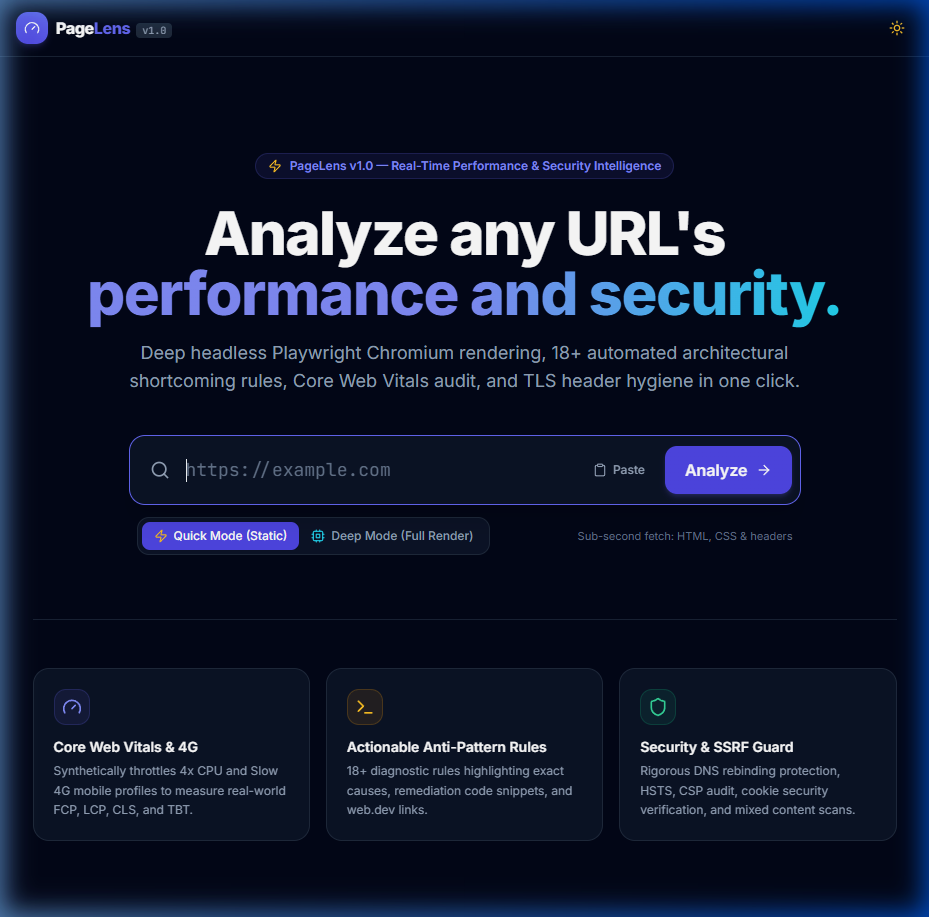
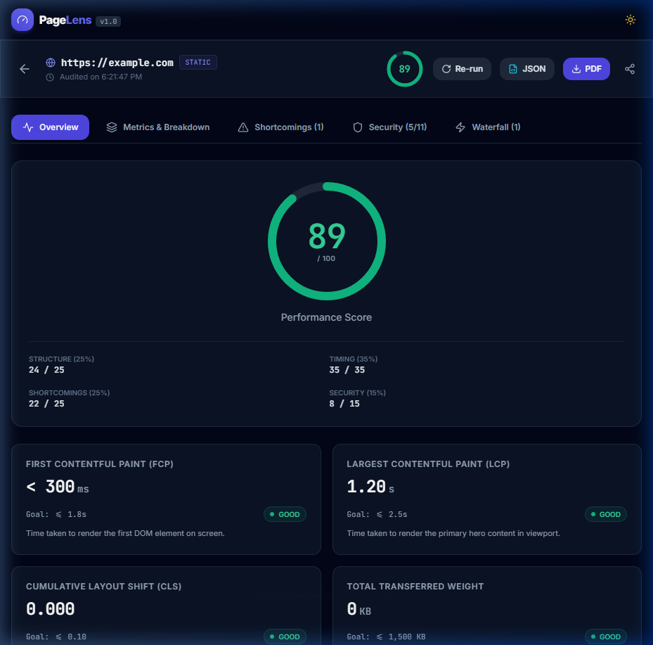
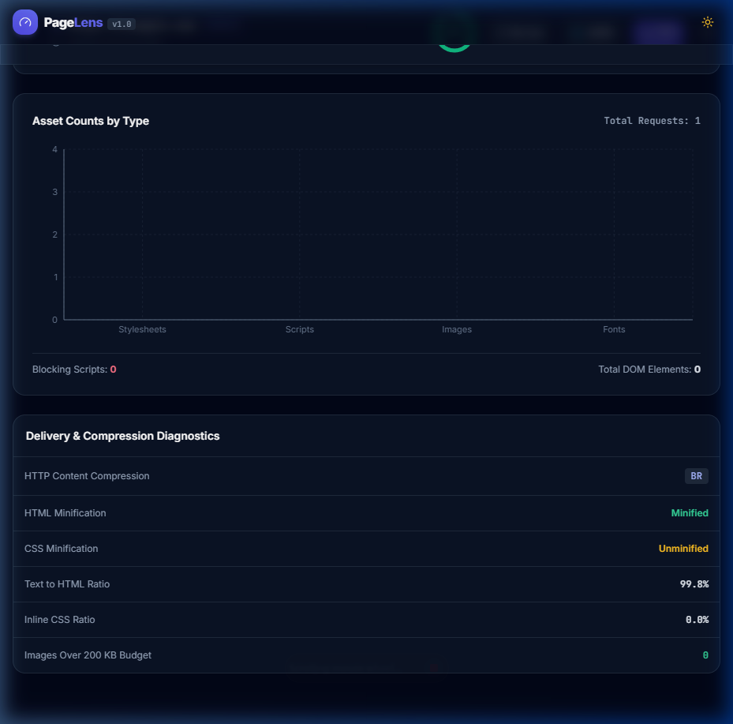
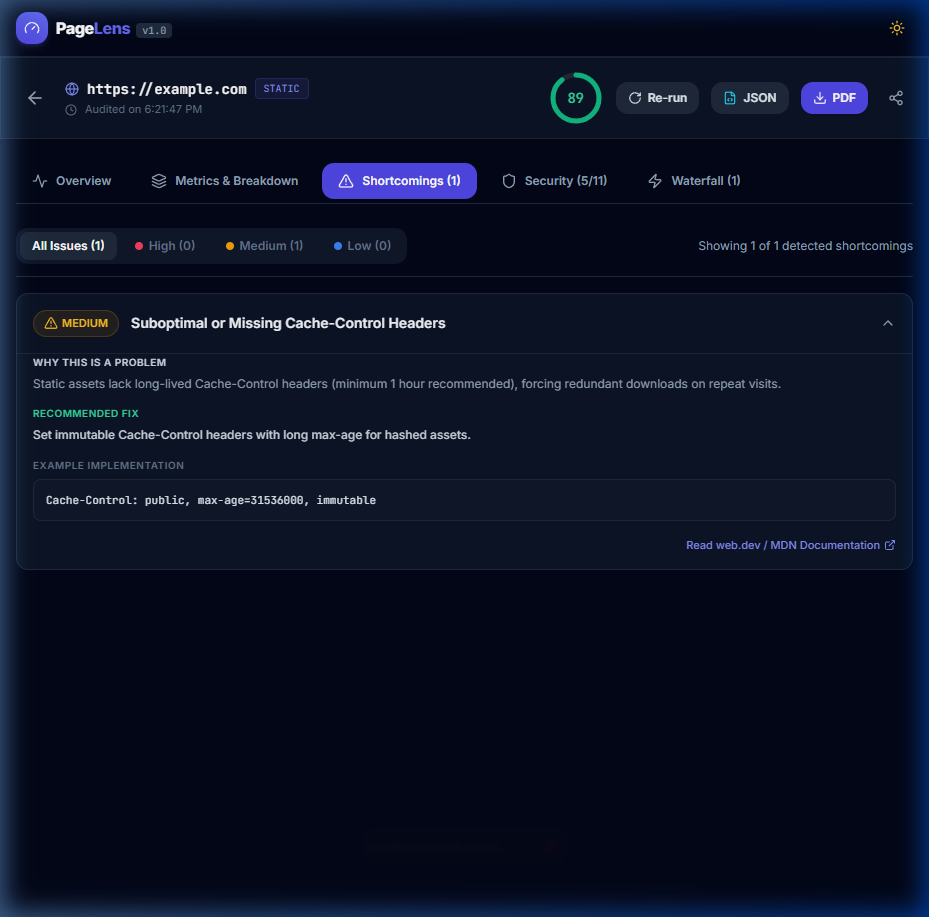
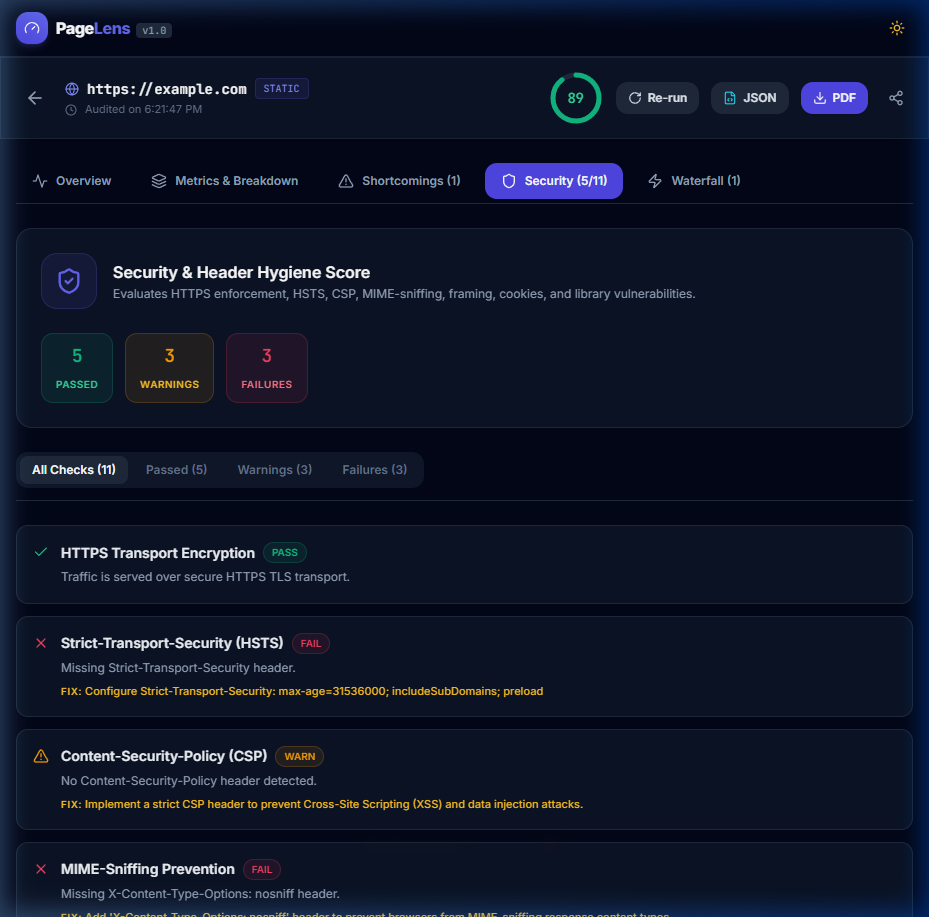
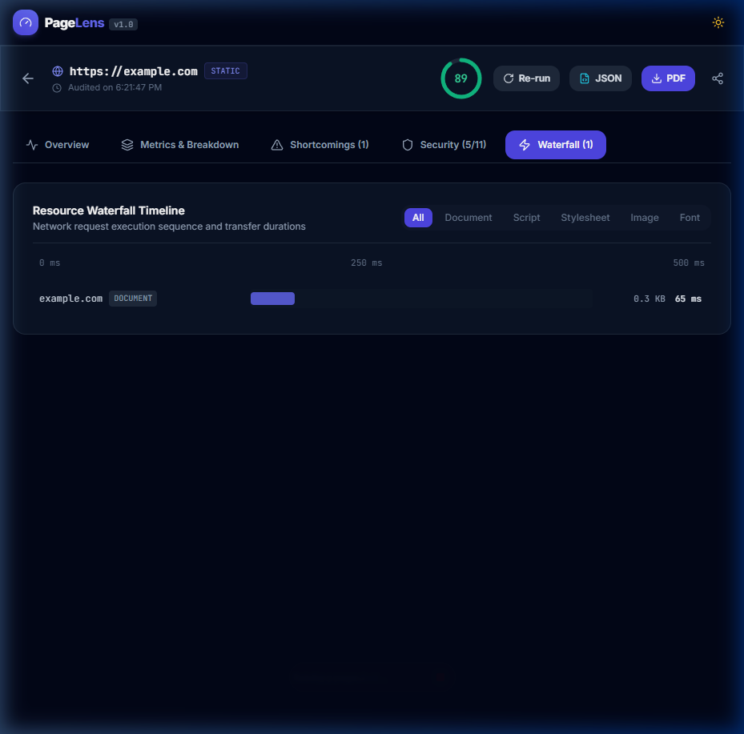

# PageLens UI & Dashboard Walkthrough

This document showcases the visual interface and user experience of **PageLens** across each primary view.

---

## 1. Home Page — Centered Hero & Audit Submission

- **Hero & Value Proposition**: Clean, developer-oriented typography with a high-contrast dark theme.
- **Large Focused URL Input**: Auto-focuses on mount, supports one-click clipboard pasting, and auto-prefixes `https://` if protocol is omitted.
- **Mode Toggle**:
  - **Quick Mode (Static)**: Fast sub-second DOM & CSS tokenization and security header audit.
  - **Deep Mode (Full Render)**: Headless Playwright Chromium with 4x CPU throttle and Slow 4G mobile network emulation.
- **Recent Analyses**: Client-side history stored in `localStorage` with direct links back to past audit reports and overall scores.

---

## 2. Report Overview — Performance Gauge & Core Web Vitals KPIs

- **Sticky Top Bar**: Displays audited URL, timestamp, small radial score badge, re-run trigger, and instant export buttons for structured JSON and formatted PDF.
- **Large Radial Score Gauge**: Animated SVG progress ring using calibrated color thresholds:
  - Green (`#22c55e`): Score >= 80 (Good)
  - Amber (`#f59e0b`): Score 50 - 79 (Needs Improvement)
  - Red (`#ef4444`): Score < 50 (Poor)
- **Score Breakdown Grid**: Shows points allocated across the 4 pillars: Structure (25%), Timing (35%), Shortcomings (25%), and Security (15%).
- **Core Web Vitals KPI Cards**:
  - First Contentful Paint (FCP)
  - Largest Contentful Paint (LCP)
  - Cumulative Layout Shift (CLS)
  - Total Transferred Weight
- **Top Priority Shortcomings**: Immediate preview of highest-impact architectural bottlenecks.

---

## 3. Metrics & Breakdown — Payload Weight & Asset Distributions

- **Donut Chart (Recharts)**: Interactive payload weight distribution across HTML, CSS, JavaScript, Images, and Fonts.
- **Bar Chart (Recharts)**: Request volume counts categorized by asset type.
- **Delivery & Diagnostics Table**: Evaluates content compression (`gzip` / `br`), HTML/CSS minification status, text-to-HTML density ratio, inline CSS ratio, and count of images exceeding the 200 KB budget.

---

## 4. Shortcomings Engine — Diagnostic Rule Remediation

- **Severity Filtering**: Filter issues by All, High, Medium, or Low severity.
- **Expandable Accordion Cards**:
  - **Why this is a problem**: Detailed technical explanation of browser overhead and user impact.
  - **Recommended Fix**: Concrete step-by-step guidance on resolving the issue.
  - **Example Implementation**: Monospaced code snippets or configuration blocks.
  - **External Reference Link**: Direct link to authoritative MDN or Google web.dev documentation.

---

## 5. Security Panel — Transport, Header & Cookie Audit

- **Hygiene Overview**: Displays counts of Passed, Warning, and Failed security checks alongside a normalized 0-100 security posture score.
- **Automated Checks**:
  - Transport Layer Security (HTTPS redirection and TLS enforcement)
  - Strict-Transport-Security (HSTS max-age, includeSubDomains, preload)
  - Content-Security-Policy (CSP default-src, script-src, frame-ancestors)
  - MIME-Sniffing Prevention (X-Content-Type-Options: nosniff)
  - Clickjacking Defenses (X-Frame-Options DENY/SAMEORIGIN)
  - Referrer Information Privacy (strict-origin-when-cross-origin)
  - Hardware Permissions Policy
  - Cookie Security Flags (Secure, HttpOnly, SameSite)
  - Mixed Content Detection
  - Outdated Client Library Vulnerabilities (jQuery, Bootstrap scans)
  - Form Action Endpoint Security

---

## 6. Waterfall Chart — Request Timeline & Transfer Latencies

- **Horizontal Gantt Timeline**: Displays request start offsets and durations relative to total page load time.
- **Type-Coded Color Bars**: Distinct visual palettes for Document, Stylesheets, Scripts, Images, and Fonts.
- **Interactive Tooltips**: Hover over bars to inspect request start offsets, duration in milliseconds, and transfer sizes in KB.

---

## 7. Scraped Source Viewer — Raw HTML & Aggregated CSS Inspection

- **Interactive Source Switcher**: Toggle seamlessly between raw fetched HTML and aggregated CSS stylesheets (including both inline `<style>` tags and resolved external stylesheets).
- **Metric Badges**: Real-time display of uncompressed byte size (KB) and total line counts.
- **Code Search & Instant Filtering**: Real-time keyword filter to quickly locate specific tags, classes, selectors, or scripts with matching line highlighting.
- **Line Numbers & Syntax-Friendly Display**: Full monospaced line-by-line rendering inside a scrollable dark theme panel.
- **One-Click Clipboard Copying**: Copies full HTML or CSS source to clipboard with instant visual feedback.
- **Direct File Downloads**: One-click download of `.html` and `.css` files via dedicated backend attachment streaming endpoints.
- **Strict XSS Immunity**: Scraped code is securely rendered as sanitized plain text strings rather than injected into the DOM, eliminating any risk of executing arbitrary scripts embedded in scraped pages.

